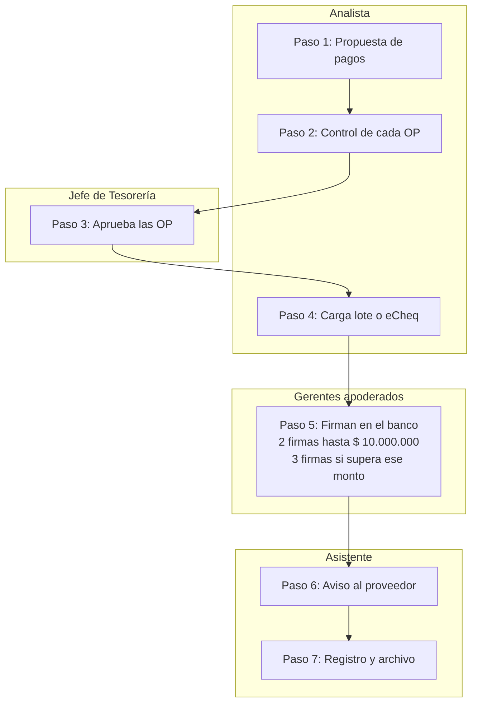

# Procedimiento de Tesorería

## 1. Objetivo, alcance y definiciones

Tesorería concentra todo el movimiento de fondos de la empresa: ningún pago se emite ni ningún cobro se registra fuera de este circuito. El procedimiento fija quién hace cada tarea, quién la aprueba y qué controles se aplican, con separación de funciones entre quien carga, quien aprueba y quien concilia.

**Alcance:** pago a proveedores, gestión de cobros, caja chica, cash flow, cuentas bancarias y conciliaciones. Aplica a todas las cuentas bancarias, billeteras y fondos en efectivo de la empresa.

**Definiciones**

| Término                 | Significado                                                                                                                                           |
|-------------------------|-------------------------------------------------------------------------------------------------------------------------------------------------------|
| eCheq                   | Cheque electrónico emitido y recibido por home banking, regulado por el BCRA (Com. "A" 6578). Es el formato preferido para pagos y cobros con cheque. |
| Cheque diferido         | Cheque con fecha de cobro futura (hasta 360 días).                                                                                                    |
| Orden de pago (OP)      | Documento interno que autoriza un pago e incluye comprobantes, retenciones e imputación.                                                              |
| Fondo fijo / caja chica | Monto en efectivo asignado para gastos menores, que se repone contra rendición.                                                                       |
| Cash flow               | Proyección de ingresos y egresos de fondos por día y por mes.                                                                                         |
| Conciliación bancaria   | Comparación entre el extracto bancario y los registros contables, con explicación de cada diferencia.                                                 |
| Esquema de firmas       | Combinación de personas habilitadas en el banco para autorizar operaciones según monto.                                                               |

## 2. Roles y responsabilidades

El Jefe aprueba y decide, el Analista prepara y controla, y el Asistente ejecuta y registra. Nadie aprueba una operación que cargó él mismo, y ningún miembro de Tesorería firma pagos en el banco: los firman los gerentes apoderados por el Directorio.

**Jefe de Tesorería**

- Aprueba la propuesta de pagos y las órdenes de pago. No firma pagos en el banco (ver sección 3).
- Aprueba el cash flow diario y mensual, administra el uso del descubierto y propone al Gerente Financiero la inversión de excedentes.
- Gestiona ante los bancos el esquema de firmas aprobado por el Directorio, los usuarios bancarios y la apertura o cierre de cuentas.
- Revisa y firma las conciliaciones bancarias y los arqueos.
- Define la política de pagos (días de pago, prioridades) junto con la Dirección.

**Analista de Tesorería**

- Arma la propuesta de pagos semanal y controla cada OP (comprobantes, retenciones, datos bancarios).
- Carga los lotes de pago en el home banking para que el Jefe los libere.
- Elabora el cash flow diario y mensual e incorpora las previsiones de Impuestos y Personal.
- Realiza las conciliaciones bancarias diarias (o el Asistente, según la carga de trabajo) y hace el seguimiento de los reportes de incidente.
- Gestiona la cobranza vencida y el descuento de eCheqs o cheques cuando lo indica el Jefe.

**Asistente de Tesorería**

- Custodia y opera la caja chica: pagos, comprobantes y rendiciones.
- Recibe y registra cobros (transferencias, eCheqs, cheques en papel) e imputa los recibos.
- Acepta o rechaza eCheqs recibidos según la validación del Analista y deposita los cheques.
- Archiva la documentación de pagos y cobros y atiende consultas de proveedores sobre pagos.
- Descarga los extractos bancarios diarios y realiza las conciliaciones cuando la carga de trabajo lo requiera.

**Matriz RACI** (R = realiza, A = aprueba, C = consultado, I = informado)

| Tarea                                                      | Jefe | Analista | Asistente | Gerentes apoderados |
|------------------------------------------------------------|------|----------|-----------|---------------------|
| Propuesta de pagos semanal                                 | A    | R        | I         | I                   |
| Carga de lote de pagos en el banco                         | I    | R        | –         | –                   |
| Firma de pagos en el banco                                 | I    | –        | –         | R/A                 |
| Registro de cobros e imputación                            | I    | A        | R         | –                   |
| Aceptación de eCheqs recibidos                             | I    | A        | R         | –                   |
| Gestión de cobranza vencida                                | A    | R        | C         | –                   |
| Caja chica: pagos y rendición                              | I    | A        | R         | –                   |
| Arqueo de caja chica                                       | A    | R        | C         | –                   |
| Cash flow diario y mensual                                 | A    | R        | C         | I                   |
| Conciliación bancaria                                      | A    | R        | R         | –                   |
| Alta o cambio de datos bancarios de proveedores            | A    | R        | –         | –                   |
| Trámite de altas y bajas de firmantes y usuarios bancarios | R    | C        | –         | I                   |

Los poderes y la designación de firmantes los aprueba el Directorio; el Jefe gestiona el trámite ante cada banco.

En ausencia del Jefe, aprueba la propuesta de pagos el reemplazo que designe la Dirección. Quien carga un pago nunca lo firma.

## 3. Cuentas bancarias, firmas y niveles de autorización

Tesorería carga los pagos pero no los firma: los firman en el banco gerentes apoderados por el Directorio, dos o tres según el monto. El Jefe de Tesorería no tiene firma bancaria.

| Monto por operación  | Firmas requeridas en el banco | Quiénes firman                        |
|----------------------|-------------------------------|---------------------------------------|
| Hasta \$ 10.000.000  | 2                             | Gerentes apoderados por el Directorio |
| Más de \$ 10.000.000 | 3                             | Gerentes apoderados por el Directorio |

Los montos y la nómina de apoderados los aprueba el Directorio y se revisan al menos una vez por año. Un pago no se divide en varias operaciones para quedar por debajo de \$ 10.000.000.

**Reglas de cuentas bancarias**

- La apertura y cierre de cuentas y la designación de firmantes los aprueba el Directorio; el Jefe de Tesorería gestiona el trámite ante cada banco.
- Cada usuario de home banking es personal; las claves y tokens no se comparten.
- Los perfiles en el banco reflejan la matriz RACI: el Jefe, el Analista y el Asistente tienen perfil de carga o consulta, nunca de firma; solo los gerentes apoderados tienen perfil de firmante.
- Al dar de baja a un empleado, se revocan sus usuarios bancarios el mismo día.
- El Asistente descarga diariamente los extractos de todas las cuentas y los guarda en la carpeta de Tesorería.

**Datos bancarios de proveedores**

- El alta o cambio de CBU/CVU de un proveedor exige una nota firmada por el proveedor y la constancia bancaria de titularidad.
- El Analista confirma el cambio por teléfono con un contacto ya registrado, nunca con el que figura en el mail que pide el cambio.
- El Jefe aprueba el cambio antes del primer pago a la nueva cuenta.

## 4. Pago a proveedores

Los pagos se hacen los días viernes salvo excepciones, solo con la documentación completa del paso 1 y si el pago está incluido en las previsiones de caja. Los medios preferidos son la transferencia y el eCheq; el cheque en papel queda como excepción autorizada por el Jefe.

*Tesorería carga y aprueba; solo los apoderados firman.*

Circuito de pago a proveedores · 7 pasos, 3 roles

El Analista prepara y carga, el Jefe aprueba, los gerentes apoderados firman y el Asistente comunica y archiva.

**Circuito**

1. **Recepción y aprobación de la factura.** Para bienes se requiere el remito firmado y la factura aprobada por el área de Compras. Para servicios se requiere la factura con la autorización del área que recibió el servicio. Sin esta documentación no se realiza el pago.
2. **Propuesta de pagos (Analista, dos días hábiles previo al pago).** Arma el listado de facturas vencidas o por vencer según condiciones pactadas y el saldo disponible del cash flow. Si un pago no figura en las previsiones de caja, lo informa al Gerente Financiero antes de incluirlo.
3. **Control de cada OP (Analista).** Verifica remito firmado o autorización del servicio, factura aprobada, que el proveedor esté activo en ARCA, retenciones de Ganancias, IVA e Ingresos Brutos según corresponda, y datos bancarios.
4. **Aprobación interna (Jefe).** Revisa la propuesta, aplica prioridades si los fondos no alcanzan y aprueba las OP.
5. **Carga en el banco (Analista).** Carga el lote de transferencias o emite los eCheqs desde el home banking.
6. **Firma (gerentes apoderados).** Firman en el banco dos apoderados los pagos de hasta \$ 10.000.000 y tres los de más de \$ 10.000.000; nadie firma un pago que no figure en la propuesta aprobada.
7. **Comunicación al proveedor (Asistente).** Envía el aviso de pago con el detalle de comprobantes cancelados y los certificados de retención.
8. **Registro y archivo (Asistente).** Adjunta el comprobante bancario a la OP, la registra y archiva.

**Medios de pago**

| Medio           | Cuándo se usa                                                                     | Puntos de control                                                                                                                         |
|-----------------|-----------------------------------------------------------------------------------|-------------------------------------------------------------------------------------------------------------------------------------------|
| Transferencia   | Medio por defecto para pagos al contado o a fecha.                                | CBU/CVU validado; lote cargado por el Analista y firmado por los apoderados según monto.                                                  |
| eCheq           | Pagos diferidos pactados con el proveedor o pagos a proveedores que lo solicitan. | Emitido a nombre del CUIT del proveedor; fecha de pago dentro del cash flow; registro del vencimiento en el calendario de pagos.          |
| Cheque en papel | Solo si el proveedor no opera con eCheq y el Jefe lo autoriza.                    | Cruzado y "no a la orden"; firmado por los apoderados según monto; chequera bajo llave del Jefe; registro de cheques emitidos y anulados. |
| Efectivo        | Solo gastos menores por caja chica (sección 6).                                   | Tope por comprobante.                                                                                                                     |

**Pagos urgentes fuera de fecha:** requieren la aprobación del Jefe y del Gerente Financiero en la OP, y la firma en el banco de los apoderados según monto, con el motivo escrito. El Analista los registra en un listado mensual de excepciones.

**Anticipos a proveedores:** solo con orden de compra firmada y aprobación del Jefe y del Gerente Financiero; el Analista hace el seguimiento hasta recibir la factura que los cancele.

## 5. Gestión de cobros

Todo cobro entra a una cuenta bancaria de la empresa y se imputa el mismo día hábil. No se reciben cobros en efectivo salvo autorización del Jefe, y nunca se usan para pagar gastos sin antes depositarlos.

**Circuito de cobro**

1. **Identificación (Asistente, diario).** Revisa los extractos y las bandejas de eCheq de todas las cuentas e identifica cada ingreso con el cliente y las facturas que cancela.
2. **Validación de eCheqs recibidos (Analista).** Antes de aceptar un eCheq verifica: CUIT del librador, que el monto y la fecha coincidan con lo pactado, y que el librador no figure en la Central de Cheques Rechazados del BCRA.
3. **Aceptación o rechazo (Asistente).** Acepta el eCheq validado en el home banking o lo rechaza con el motivo, y avisa al cliente.
4. **Depósito o custodia.** Los eCheqs al día se depositan en el momento. Los diferidos quedan en custodia en el banco hasta su fecha, salvo que el Jefe decida descontarlos o endosarlos.
5. **Imputación (Asistente).** Emite el recibo, aplica el cobro a las facturas y registra las retenciones sufridas con sus certificados.
6. **Control (Analista).** Si un ingreso no se puede identificar, se consulta al banco su origen; si no se conoce la procedencia, se abre un reporte de incidente (sección 8).

**Cheques en papel recibidos:** se reciben solo cruzados y a nombre de la empresa. El Asistente los registra en la planilla de valores en cartera y los deposita a más tardar el día hábil siguiente.

**Cheques o eCheqs rechazados:** el Asistente avisa al Analista en el día. El Analista reclama al cliente, revierte la imputación y le informa al Jefe y a Comercial; el cliente queda bloqueado para nuevas ventas a crédito hasta regularizar.

**Cobranza vencida**

| Días de atraso | Acción                                             | Responsable                       |
|----------------|----------------------------------------------------|-----------------------------------|
| 1 a 7          | Recordatorio por mail con el estado de cuenta.     | Asistente                         |
| 8 a 30         | Llamado al cliente y compromiso de pago con fecha. | Analista                          |
| 31 a 60        | Aviso a Comercial y suspensión de crédito.         | Analista, con aprobación del Jefe |
| 61 a 90        | Intimación formal de pago.                         | Jefe                              |
| Más de 90      | Gestión especial (ver abajo).                      | Jefe, con el Gerente Financiero   |

**Cuentas por cobrar con más de 90 días:** se gestionan en forma especial.

- Se llevan en un listado separado, con el detalle de cada cliente, importe, antigüedad y gestiones realizadas.
- El Jefe revisa cada caso con el Gerente Financiero y Comercial y define la acción: plan de pagos, acuerdo, cobranza extrajudicial o gestión legal.
- Contabilidad evalúa la previsión por incobrabilidad.
- El cliente queda sin crédito hasta regularizar, y el listado se revisa al menos una vez por mes.

El Analista emite cada semana el listado de deudores por antigüedad (aging) y lo envía al Jefe y a Comercial.

## 6. Caja chica (fondo fijo)

La caja chica es un fondo fijo de 1,000.000 Pesos a cargo del Asistente, para operaciones diarias: viáticos de cadetes y transportistas y gastos menores de la operatoria de la empresa. En todo momento, efectivo más comprobantes debe sumar el monto del fondo.

**Reglas**

- Tope por gasto: 300.0000 . Un gasto mayor va por el circuito de pago a proveedores.
- Todo egreso requiere comprobante válido (factura o ticket a nombre de la empresa) y la firma de quien recibe el dinero.
- Fondos a rendir: solo se entregan a personas autorizadas por el Gerente Financiero, contra vale firmado. La persona rinde los gastos con sus comprobantes en un plazo de \[a definir\] días hábiles y no recibe nuevos fondos hasta rendir.
- No se cambian cheques, no se hacen préstamos personales y no se mezcla el fondo con dinero propio.
- El efectivo se guarda en caja fuerte; solo el Asistente y el Jefe tienen acceso.

**Rendición y reposición**

1. Cuando se usa el 70% del fondo, o al cierre de cada mes, el Asistente arma la rendición con los comprobantes ordenados y la planilla de gastos.
2. El Analista controla los comprobantes, su imputación contable y que respeten los topes.
3. El Jefe aprueba la rendición.
4. Se repone el monto rendido por transferencia o cheque a nombre del Asistente, que lo retira y lo ingresa al fondo.

**Arqueos**

- El Analista hace un arqueo diario 30 minutos antes del cierre de la jornada laboral
- El acta de arqueo detalla billetes, vales y comprobantes, y la firman ambos.
- Cualquier diferencia se informa al Jefe en el día; si no se explica, se registra como faltante y se analiza con la Dirección.

## 7. Cash flow

El cash flow se prepara en forma diaria y mensual, y es la base de las decisiones de pago, cobro, financiamiento e inversión. Lo prepara el Analista y lo aprueba el Jefe. Todo pago debe estar en las previsiones de caja; si no lo está, se informa al Gerente Financiero antes de programarlo.

| Informe           | Frecuencia                              | Horizonte                    | Contenido                                                                                                                       | Destinatario              |
|-------------------|-----------------------------------------|------------------------------|---------------------------------------------------------------------------------------------------------------------------------|---------------------------|
| Cash flow diario  | Diario, antes de las 10 h               | Día y próximos días hábiles  | Saldo de cada cuenta, uso de la línea en descubierto, cobros y pagos del día, eCheqs por vencer e inversiones.                  | Jefe                      |
| Cash flow mensual | Mensual, en los primeros 5 días hábiles | Mes siguiente y 3 a 12 meses | Proyección por rubro (cobranzas, proveedores, impuestos, sueldos), real vs. proyectado y explicación de desvíos mayores al 10%. | Jefe y Gerente Financiero |

**Previsiones que envían otras áreas**

| Área                      | Qué envía                                                                         | Cuándo                           |
|---------------------------|-----------------------------------------------------------------------------------|----------------------------------|
| Responsable de impuestos  | Estimado de los tributos a pagar en el mes siguiente, con sus vencimientos.       | Últimos días hábiles de cada mes |
| Departamento de Personal  | Estimado de sueldos, cargas sociales y otros pagos al personal del mes siguiente. | Últimos días hábiles de cada mes |
| Compras / Cuentas a Pagar | Facturas aprobadas y compromisos de pago con proveedores.                         | Diario                           |

El Analista incorpora estas previsiones al cash flow, junto con los cobros esperados según el aging de clientes y los vencimientos de eCheqs. Si un área no envía su previsión a tiempo, lo informa al Jefe.

**Faltantes: línea de crédito en descubierto**

- La empresa tiene una línea de crédito en descubierto con su banco principal, para cubrir faltantes transitorios.
- El objetivo es minimizar su uso: antes de recurrir al descubierto, el Jefe evalúa adelantar cobranzas, descontar eCheqs o reprogramar pagos no prioritarios.
- Si el cash flow prevé usar el descubierto, el Jefe lo informa al Gerente Financiero y, cuando sea necesario, negocian la tasa con el banco.
- El Analista controla a diario el saldo utilizado y los intereses debitados.

**Excedentes: inversiones de corto plazo**

- Si el cash flow prevé un excedente, el Jefe propone invertirlo en instrumentos de corto plazo (por ejemplo, plazo fijo, fondos money market o caución).
- Toda inversión requiere la aprobación previa del Gerente Financiero.
- El plazo de la inversión no supera la fecha en que el cash flow prevé necesitar esos fondos.

**Orden de prioridad cuando los fondos no alcanzan:** sueldos y cargas sociales, impuestos, servicios críticos, proveedores estratégicos y luego el resto por antigüedad.

## 8. Conciliaciones bancarias y cierre mensual

Cada cuenta bancaria se concilia todos los días hábiles. La conciliación la realiza el Analista o el Asistente, según la carga de trabajo, y el Jefe la revisa. Todo débito o crédito que no se pueda explicar abre un reporte de incidente.

1. Se descargan los extractos y movimientos del día de cada cuenta, incluidos los eCheqs emitidos, recibidos y en custodia.
2. Se comparan con los registros de Tesorería y se identifica cada movimiento.
3. **Débitos:** los gastos bancarios (comisiones, impuesto a los débitos y créditos, percepciones) se registran. Cualquier otro débito no reconocido abre un reporte de incidente el mismo día y se verifica su motivo con el banco.
4. **Créditos:** si no se identifica el origen, se consulta al banco. Si aun así no se conoce la procedencia, se abre un reporte de incidente y los fondos no se imputan ni se usan hasta aclararlo.
5. Se proponen a Contabilidad los asientos de ajuste.
6. El Jefe revisa las conciliaciones y el estado de los incidentes abiertos, y firma la conciliación mensual de cada cuenta.

**Reporte de incidente**

- Lo abre quien realiza la conciliación y lo informa al Jefe en el día.
- Registra fecha, cuenta, importe, descripción del movimiento, consultas realizadas, responsable y estado.
- Se cierra cuando se identifica el motivo y se regulariza (reclamo al banco, devolución, imputación o ajuste).
- Los incidentes se llevan en un registro único que revisa el Jefe; los que sigan abiertos al cierre de mes se informan al Gerente Financiero.

**Cierre de Tesorería del mes:** conciliaciones mensuales firmadas, registro de incidentes abiertos, arqueo de caja chica, inventario de eCheqs en custodia y cheques en cartera, listado de pagos de excepción y cash flow real vs. proyectado.

## 9. Controles internos, indicadores y registros

**Controles clave**

- Separación de funciones: quien carga no firma y quien custodia la caja chica no la arquea; el Jefe revisa las conciliaciones, las haga el Analista o el Asistente.
- Firma bancaria de dos gerentes apoderados (hasta \$ 10.000.000) o tres (más de \$ 10.000.000); Tesorería no firma pagos.
- Validación telefónica de todo cambio de datos bancarios de proveedores.
- Verificación de libradores en la Central de Cheques Rechazados antes de aceptar eCheqs.
- Arqueos sorpresivos mensuales, conciliaciones bancarias diarias y reporte de incidente para todo movimiento no identificado.
- Revisión anual de firmantes, usuarios bancarios y niveles de autorización.

**Indicadores** (los informa el Analista al Jefe cada mes)

| Indicador                                  | Qué mide                                          | Meta          |
|--------------------------------------------|---------------------------------------------------|---------------|
| Días promedio de cobro (DSO)               | Tiempo entre factura y cobro.                     | \[a definir\] |
| Días promedio de pago (DPO)                | Tiempo entre factura y pago a proveedores.        | \[a definir\] |
| Desvío del cash flow                       | Real vs. proyectado del mes.                      | Menos de 10%  |
| Pagos fuera de fecha                       | Cantidad de pagos urgentes o de excepción.        | \[a definir\] |
| Partidas de conciliación de más de 30 días | Pendientes sin explicar.                          | Cero          |
| Incidentes de conciliación abiertos        | Débitos o créditos no identificados sin resolver. | Cero          |

**Registros y archivo**

| Registro                                          | Responsable | Conservación                            |
|---------------------------------------------------|-------------|-----------------------------------------|
| Órdenes de pago con comprobantes bancarios        | Asistente   | 10 años                                 |
| Recibos de cobro y certificados de retención      | Asistente   | 10 años                                 |
| Rendiciones y actas de arqueo de caja chica       | Asistente   | 10 años                                 |
| Conciliaciones bancarias firmadas                 | Analista    | 10 años                                 |
| Cash flow diario y mensual                        | Analista    | 5 años                                  |
| Altas y cambios de datos bancarios de proveedores | Analista    | Mientras dure la relación y 10 años más |

Este procedimiento lo revisa el Jefe de Tesorería una vez por año o cuando cambie la estructura, la normativa del BCRA o ARCA, o los sistemas bancarios.
